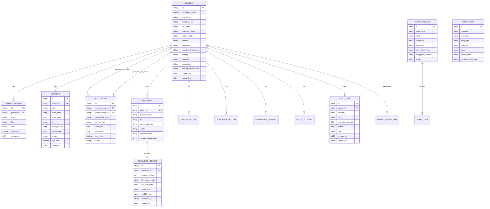
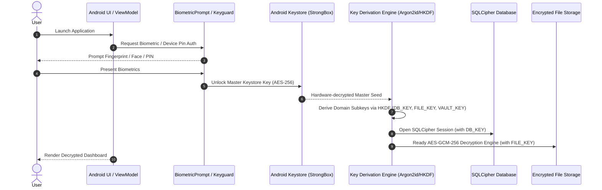
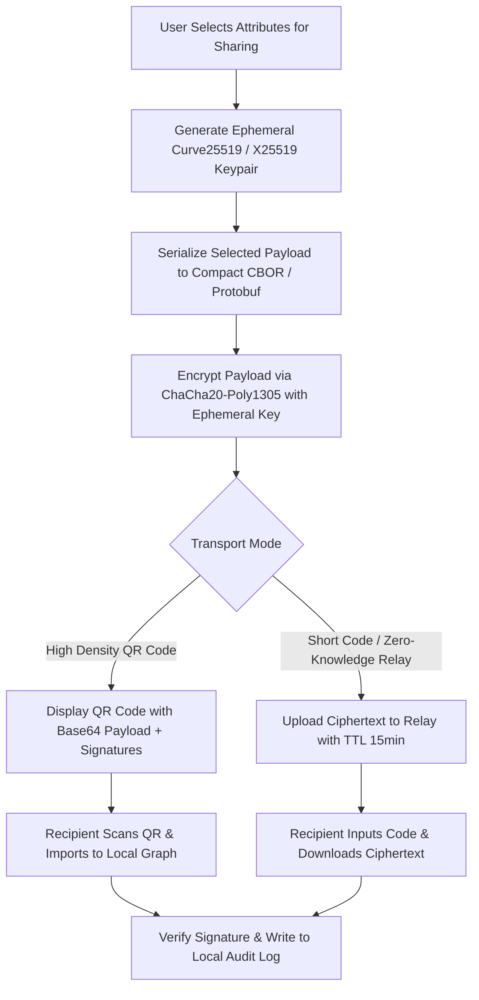

# System Architecture & Technical Specification
## Personal Information Management System (PIMS) & Identity Vault

**Document Version:** 1.1.0  
**Target Platform:** Android 13+ (API 33+)  
**Primary Language & Stack:** Kotlin, Jetpack Compose, Room (SQLCipher / Encrypted SQLite), Android Keystore, Tink / Jetpack Security Crypto, KotlinX Coroutines & Flow, WorkManager, BiometricPrompt.

> **Agent & Planning Docs:** See [AGENTS.md](./AGENTS.md) (project-wide), [app/AGENTS.md](./app/AGENTS.md) (app module), and [docs/planning/](./docs/planning/) (roadmap, phases, workflow, ADRs). App mirrors planning in `core/model/PlanningPhase.kt`.

---

## 1. System Overview & Scope

### 1.1 Executive Summary
The **Personal Information Management System (PIMS)** is a secure, local-first personal identity vault, relationship graph, and selective profile-sharing platform. The system operates under the core privacy paradigm: **"The user owns the data, the device protects the data, and the user explicitly authorizes any boundary crossing."**

### 1.2 Core Security Classifications (Zones)

```mermaid
graph TD
    subgraph Zone 0 & 1: General Profile [Classification: Public / Personal]
        A1[Basic Identity: Name, Occupation]
        A2[General Contact Details: Public Email, Phone]
        A3[Public Online Presence: LinkedIn, Portfolio]
    end

    subgraph Zone 2 & 3: Sensitive Profile [Classification: Private / Sensitive]
        B1[Addresses & Residential History]
        B2[Full Relationship Graph & Kinship]
        B3[Education & Career History]
        B4[Medical Profile: Allergies, Meds, Conditions]
        B5[Document Vault: Passports, National IDs, Degrees]
    end

    subgraph Zone 4: Security Vault [Classification: Critical]
        C1[Account Passwords & Master Pins]
        C2[TOTP 2FA Seeds & Recovery Codes]
        C3[Payment References - Tokenized / Last 4]
        C4[Asymmetric Private Keys & Pairing Secrets]
    end

    style Zone 0 & 1 fill:#e1f5fe,stroke:#0288d1,stroke-width:2px;
    style Zone 2 & 3 fill:#fff3e0,stroke:#f57c00,stroke-width:2px;
    style Zone 4 fill:#ffebee,stroke:#d32f2f,stroke-width:2px;
```

---

## 2. System Requirements

### 2.1 Functional Requirements (FR)

* **FR-01: Multi-Persona & Multi-Entity Management:** Support the primary account owner and related entity profiles (family members, dependents, doctors, colleagues) with configurable depth.
* **FR-02: Flexible Attribute Modeling:** Dynamic support for multiple contact points (phone, email), multi-line internationalized addresses, and occupational timelines.
* **FR-03: Immutable Versioned Document Vault:** Store binary attachments (PDF, JPEG, PNG, WEBP) inside application-private encrypted storage. Support version histories with SHA-256 integrity checks and rolling audit trails.
* **FR-04: Kinship & Relationship Graph:** Model bidirectional and directed interpersonal relationships with verification states, roles, and temporal validity (start/end dates).
* **FR-05: Medical Profile & Emergency Card:** Segregated medical records with the capability to generate an unencrypted or pin-gated lockscreen-accessible Emergency Medical Summary (Blood type, critical allergies, emergency ICE contacts).
* **FR-06: Critical Security Vault:** Dedicated isolated storage for 2FA TOTP secrets (RFC 6238), recovery codes, credentials, and payment references (excluding sensitive CVV/PINs).
* **FR-07: Selective Disclosure & Share Package Engine:** User-curated attribute selection producing encrypted, time-bound ephemeral packages for QR code or short-code transmission.
* **FR-08: Cryptographic Peer Pairing & Sync:** Local-first zero-knowledge device pairing via authenticated key exchange (Noise protocol / ECDH over QR + local WiFi/Bluetooth or zero-knowledge relay).
* **FR-09: Tamper-Evident Audit Logging:** Cryptographically chained event log recording create, read, update, delete, share, and export operations.

### 2.2 Non-Functional Requirements (NFR)

* **NFR-01: Zero-Cloud Dependency (Offline-First):** All CRUD operations, cryptographic handshakes, and UI workflows function without active network connectivity.
* **NFR-02: Cryptographic Rigor:** AES-256-GCM authenticated encryption for files and database payloads; keys rooted in hardware-backed Android Keystore (`StrongBox` where available).
* **NFR-03: Performance:** Cold startup to biometric prompt `< 400ms`; database query execution for typical entity lists `< 25ms`.
* **NFR-04: Resilience & Anti-Tamper:** Immediate memory wiping of sensitive plaintext char arrays / key bytes; automatic UI masking in Android Recents (`FLAG_SECURE`).
* **NFR-05: Configurable Auto-Lock:** Hardware-assisted session revocation on backgrounding (immediate, 30s, 1m, 5m, 15m).

---

## 3. Database Architecture & ER Model

The relational layer is powered by **Room with SQLCipher**. Below is the normalized schema mapping:



---

## 4. Cryptographic Security Architecture



### 4.1 Key Hierarchy & Isolation
1. **Master Key (MK):** Hardware-backed 256-bit AES key generated in Android Keystore with `PURPOSE_ENCRYPT | PURPOSE_DECRYPT`, requiring user authentication per biometric auth timeout window.
2. **Domain Key Derivation (HKDF-SHA256):**
   * `DB_ENCRYPTION_KEY = HKDF-Expand(MK, "pims-sqlite-cipher-v1", 32)`
   * `FILE_ENCRYPTION_KEY = HKDF-Expand(MK, "pims-file-storage-v1", 32)`
   * `VAULT_ENCRYPTION_KEY = HKDF-Expand(MK, "pims-critical-vault-v1", 32)`
3. **Audit Log Hash Chaining:**
   $$\text{Hash}_n = \text{HMAC-SHA256}(\text{EventData}_n \mathbin{\Vert} \text{Hash}_{n-1}, \text{AUDIT\_KEY})$$
   Guarantees tamper evidence and sequential non-repudiation.

### 4.2 Durable Domain-Key Initialization and Format Compatibility

Domain subkeys are generated only when no wrapped material exists. Before returning a newly generated subkey for encryption, the implementation must durably store and confirm its Keystore-wrapped ciphertext and IV. If persistent storage is unavailable or does not confirm both values, initialization fails closed and the transient key is wiped; callers must not write ciphertext with it. Existing wrapped-key authentication failures must preserve the stored bytes and must never create a replacement key.

Vault payloads must retain compatible readers for every supported historical key/format path until records carry explicit version metadata and each migration has authenticated the old payload, written a new version, and authenticated read-back. A key-alias or derivation change must not overwrite old key material or change stable person/item identifiers. See ADR-012, ADR-014, ADR-015, and ADR-017.

---

## 5. Android Clean Architecture Implementation

### 5.1 Stable Person Identity and Recoverable Photos

`Person.id` is the stable random identifier for an individual. The account authentication UID identifies the Firebase account namespace; it is not a person identifier. National ID numbers are optional, sensitive profile attributes and must not be used as primary keys, relationship keys, filenames, or cloud paths. Person-linked notes, photos, and vault records retain their stable person and record IDs through sync and crypto upgrades.

Person avatars use two neutral built-in default icons until a person has a user-selected image, a restored image, or an image explicitly imported from the signed-in Google profile. Image selection and Google import require a user action. Photo bytes are encrypted before cloud upload and metadata is scoped to the account and stable person ID. Restore validates ownership, format, and integrity before updating the local photo pointer.

Personal notes use a month-calendar overview. Separate note/reminder markers use local calendar dates; selecting a date includes notes created on that date and unfinished reminders due then. The default list shows up to four pinned notes, falling back to the four most recently updated notes. Schema 16 adds `plain_notes.is_pinned` with a false default; pin updates patch that field and preserve content/attachments. Schema-15 backups remain accepted and are migrated by Room on startup. See [ADR-020](docs/planning/adr/ADR-020-calendar-notes-and-pins.md).

Personal notes use a month-calendar overview. Separate note/reminder markers use local calendar dates; selecting a date includes notes created on that date and unfinished reminders due then. The default list shows up to four pinned notes, falling back to the four most recently updated notes. Schema 16 adds `plain_notes.is_pinned` with a false default; pin updates patch that field and preserve content/attachments. Schema-15 backups remain accepted and are migrated by Room on startup. See [ADR-020](docs/planning/adr/ADR-020-calendar-notes-and-pins.md).

Protected personal notes keep their local data in the SQLCipher database and are encrypted again for account sync with the portable file key. Firestore stores only ciphertext for title, content, format, pin state, and reminder metadata; note and attachment identifiers plus owner IDs are authenticated as associated data. Protected attachment captions use the same account-scoped key with attachment-specific associated data. Older protected-note cloud documents are upgraded after successful authentication, and restore skips any protected payload that fails authentication. See [ADR-016](docs/planning/adr/ADR-016-protected-note-sync.md).

Relationship-note attachments use encrypted app-private files and a Room child table keyed by stable attachment IDs. Public relationship-note attachments sync as portable-file-key encrypted blobs under the account's relationship-note attachment subcollection; private notes and their attachments remain device-only. Input is restricted to JPEG, PNG, and PDF up to 10 MiB, and larger cloud blobs require configured object storage. Downsync authenticates ciphertext before local encrypted storage; images and the first PDF page are rendered from memory with `FLAG_SECURE`, and plaintext byte buffers are cleared when preview closes. Passphrase backups include attachment blobs and restore them into deterministic encrypted paths that match the restored database metadata. See [ADR-018](docs/planning/adr/ADR-018-relationship-note-attachments.md).

New vault payloads use a vault key derived from the portable root key with `PIMS/vault/v2`, then wrapped locally by a per-use Android Keystore key that requires `BIOMETRIC_STRONG`. The prompt receives a `CryptoObject`; vault key bytes are unavailable until the authorized operation completes. The root-wrapped `PIMS/vault/v1` key remains a read-only migration candidate for legacy ciphertext and retained archives. New devices must restore the same portable key to decrypt synchronized v2 payloads. See [ADR-017](docs/planning/adr/ADR-017-auth-bound-vault-key.md).

### 5.2 Encrypted Payload Compatibility

Full-vault backup uses a consistent encrypted SQLCipher export, referenced encrypted files, supported photo/wallpaper preferences, and passphrase-protected recovery keys. Restore validates an isolated database, clears source-device sync operations, and stages encrypted replacement payloads. A startup journal swaps database/files/key preferences before Room/providers initialize and rolls back interrupted replacement. Recovery opens local-only and signs out cloud credentials. Zone 4 elevation and explicit file selection are required; schema and bounded package-size restrictions fail closed. Native and cross-device acceptance remain pending as the final validation stage. See [ADR-019](docs/planning/adr/ADR-019-full-vault-backup-safety-gate.md).

Encrypted records and file payloads must carry or resolve an explicit crypto-format and key-derivation version. Readers retain support for every format still present in local data or supported backups. Upgrades use a recoverable sequence: authenticate and decrypt the old payload, encrypt into a new version, persist the new version without changing record/person IDs, and authenticate read-back before retiring the old copy. Interruption or failure leaves the previous payload available. See [ADR-012](./docs/planning/adr/ADR-012-person-photos-and-crypto-format-migration.md).

Room schema version 13 adds `encryption_format_version` and `encryption_key_version` to vault items. Migration 12→13 tags existing rows as version 1 without changing ciphertext; version 14 retains each source ciphertext in a migration archive. New and migrated rows use key version 2. If a v2 read fails, the app authenticates the archived v1 payload with a legacy candidate before restoring it and retrying migration. Firestore treats omitted markers as version 1 for older clients and rejects unsupported versions. Version 1 readers and key material remain necessary until each migration is authenticated and its recovery conditions are satisfied. See [ADR-015](docs/planning/adr/ADR-015-versioned-vault-payload-migration.md) and [ADR-017](docs/planning/adr/ADR-017-auth-bound-vault-key.md).

```text
app/src/main/java/com/pims/vault/
│
├── core/
│   ├── crypto/                 # Keystore, HKDF, Biometric wrappers, AES-GCM
│   ├── database/               # Room Database, Converters, SQLCipher Drivers
│   ├── model/                  # Core domain models & Enums (Classification, Types)
│   └── common/                 # Result wrappers, Dispatcher providers, Extensions
│
├── data/
│   ├── local/
│   │   ├── dao/                # PersonDao, DocumentDao, RelationshipDao, VaultDao
│   │   ├── entity/             # Room Database Entities
│   │   └── storage/            # EncryptedFileStorage (App-private scoped storage)
│   └── repository/             # Concrete implementations of Domain Repositories
│
├── domain/
│   ├── repository/             # Abstract Repository Interfaces
│   └── usecase/
│       ├── profile/            # GetPersonGraphUseCase, SaveProfileUseCase
│       ├── document/           # IngestDocumentVersionUseCase, VerifyIntegrityUseCase
│       ├── sharing/            # CreateSharePackageUseCase, DecryptSharePackageUseCase
│       └── vault/              # ManageVaultItemUseCase, GenerateTotpTokenUseCase
│
└── presentation/
    ├── ui/
    │   ├── theme/              # Material3 Theme, Color Palettes, Typography
    │   ├── navigation/         # Navigation Graph, Routes, Deep links
    │   ├── home/               # Dashboard, Category Cards, Quick Actions
    │   ├── profile/            # Person Details, Contact methods, Address timelines
    │   ├── relationships/      # Visual Kinship Graph, Related Person Linker
    │   ├── documents/          # Document Vault, Version History, File Preview
    │   ├── medical/            # Medical Dossier, Emergency Lockscreen Card Generator
    │   ├── vault/              # Isolated Master-Auth Authenticator & Credentials Vault
    │   └── sharing/            # Selective Sharing Picker, QR Generator & Scanner
    └── viewmodel/              # MVI / MVVM ViewModels with unidirectional state flow
```

---

## 6. Selective Sharing & Ephemeral Exchange Protocol



---

## 7. Implementation Roadmap (see docs/planning/ROADMAP.md for live status)

| Phase | Milestone | Deliverables |
| :--- | :--- | :--- |
| **Phase 0** | **Planning System** | AGENTS.md (root + app), docs/planning/ (ROADMAP, PHASES, WORKFLOW, ADRs), PlanningPhase.kt + feature flags, CI sync check. |
| **Phase 1** | **Core Foundation & Security** | Gradle build config with Kotlin 2.0+, SQLCipher Room setup, Android Keystore manager, Biometric unlock flow. |
| **Phase 2** | **Domain Entities & Storage** | Room DAOs, Encrypted file manager for document versions, SHA-256 integrity verifier, Audit log system. |
| **Phase 3** | **UI Design System & Core Features** | Material3 Jetpack Compose UI, Dynamic Form builder with placeholder guidance, Profile & Timeline views. |
| **Phase 4** | **Relationship Graph & Medical Dossier** | Kinship linker, Interactive Graph view, Emergency Medical Card (lockscreen/quick-access export). |
| **Phase 5** | **Security Vault (Zone 4)** | Re-auth gated vault screen, TOTP generator (RFC 6238), Tokenized payment cards, Encrypted notes. |
| **Phase 6** | **Selective Sharing & Pairing** | Dynamic field selector, Compact QR code engine (ZXing / CameraX), Offline P2P import & audit confirmation. |
| **Phase 7** | **Hardening & Release** | Adversarial tests, R8, SBOM, staged rollout per docs/release/RELEASE_CHECKLIST.md. |

> **Planning is the source of truth:** `docs/planning/ROADMAP.md` tracks status, `docs/planning/PHASES.md` defines DoD, `docs/planning/WORKFLOW.md` defines branch→PR→CI→merge. App gates unfinished phases via `core/model/PlanningPhase.kt`.
