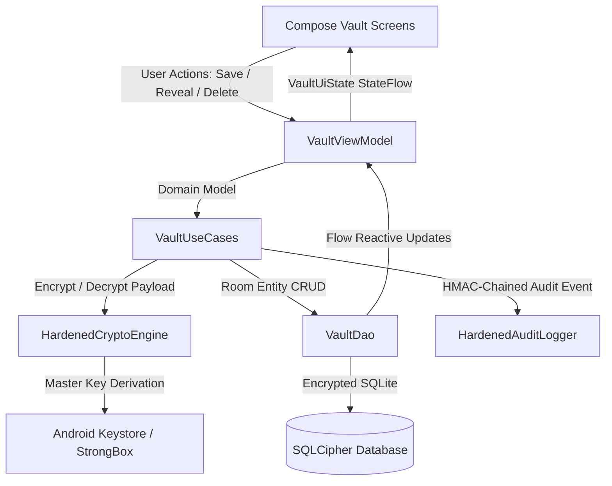

# ARCHITECTURE.md — Persona Vault Architecture & Data Flow

## Platform & Technology Stack
- **OS**: Android 13+ (API 33+)
- **Language**: Kotlin 2.0 (JVM target 17)
- **UI**: Jetpack Compose + Material3
- **Local Storage**: SQLCipher + Room ORM (`VaultItemEntity`, `VaultDao`)
- **Crypto Engine**: `HardenedCryptoEngine` (AES-256-GCM + HKDF-SHA256, StrongBox/TEE Keystore)
- **State Management**: Android MVVM (`VaultViewModel`, Kotlin Coroutines `StateFlow`)
- **Dependency Injection**: Hilt

## Architecture Pattern
Standard Clean Architecture with unidirectional data flow (MVI/MVVM):
`UI Views (Compose) ↔ VaultViewModel ↔ Domain UseCases ↔ VaultDao / SQLCipher ↔ Hardware Keystore`

## Data Payloads & Serialization
To avoid schema migrations on every newly introduced credential type while strictly preserving zero-knowledge encryption:
1. `VaultItemEntity` stores:
   - `id`: UUID
   - `personId`: Owner ID
   - `category`: `VaultCategory` (PASSWORD, API_KEY, SSH_KEY, ACCESS_TOKEN, RECOVERY_CODE, PAYMENT_REFERENCE, BANK_ACCOUNT, IDENTITY_CREDENTIAL, GENERIC_SECRET)
   - `title`: Display label (e.g. "Stripe API key", "Gmail")
   - `accountIdentifier`: Subtitle identifier (e.g. "Production", username)
   - `encryptedPayload`: AES-256-GCM combined ciphertext + tag
   - `encryptionIv`: 12-byte IV hex string
   - `notes`: Optional non-sensitive notes or stored encrypted inside payload
2. Decrypted payloads are structured models (`ApiKeySecret`, `SshKeySecret`, `AccessTokenSecret`, `PasswordSecret`, etc.) zeroized immediately upon scope disposal.

## Key Decisions
1. **Dynamic Real-Time Persistence**: All screens are backed directly by Room queries via Kotlin `Flow`. No in-memory mocking or dummy seeders.
2. **Zone 4 Re-Authentication**: Access to secrets requires active biometric session verification (`BiometricSessionManager`). Auto-locks after 5 minutes of inactivity.
3. **Clipboard Protection**: ClipboardManager writes set `FLAG_SENSITIVE` and automatically zeroize data after a safe window.
